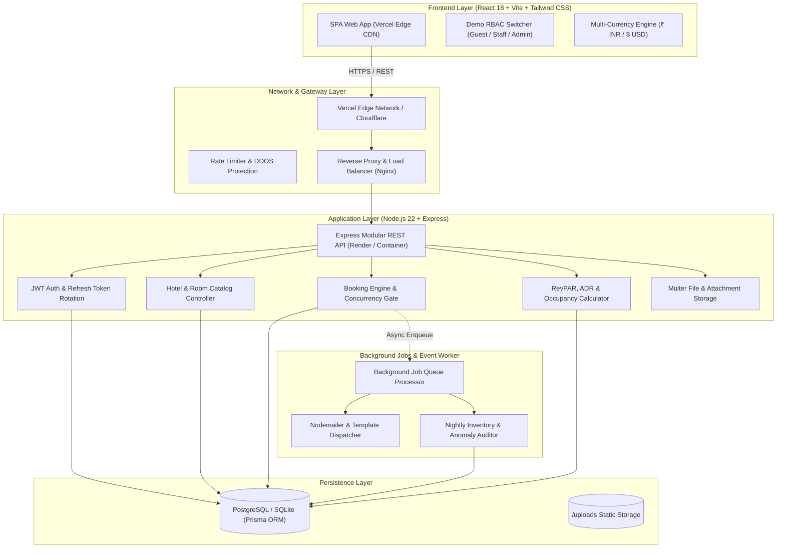
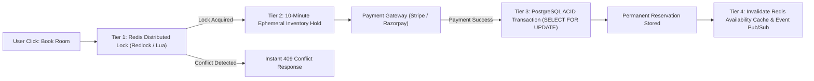

# System Architecture & Deep Scaling Blueprint
## Aura Stays Mumbai Boutique Hospitality Platform

This document details the end-to-end system architecture of Aura Stays Mumbai, an analysis of the primary architectural bottleneck in hospitality reservation platforms, and a production-grade roadmap to scale it to millions of concurrent requests.

---

## 1. System Architecture Diagram



---

## 2. Deep Dive: Scaling the Weakest Part of the Design

### The Core Problem: The Temporal Concurrency Bottleneck (Double-Booking Prevention)

In standard e-commerce, inventory items are fungible units: decreasing stock is an atomic decrement:
$$\text{inventory} = \text{inventory} - 1$$

In boutique hospitality, however, room inventory is **temporally dimensional**:
- A single room unit (e.g., Room 101: *Colonial Heritage Grand Suite* at *The Colaba Heritage Manor*) is reserved over an **interval of dates** $[T_{\text{check-in}}, T_{\text{check-out}})$.
- Two reservation requests conflict **if and only if** their date ranges overlap:
$$\text{Conflict} \iff (T_{\text{in}}^{(A)} < T_{\text{out}}^{(B)}) \land (T_{\text{out}}^{(A)} > T_{\text{in}}^{(B)})$$

#### Why This Breaks Under High Velocity (Flash Sales & Seasonal Surges)
During peak Mumbai seasonal demand (e.g. New Year's Eve in Marine Drive, South Mumbai art festivals in Kala Ghoda, or celebrity wedding seasons in Bandra/Juhu), hundreds of users simultaneously attempt to book the identical suite.

In a naive architecture:
1. Thread A queries: `SELECT * FROM bookings WHERE roomId = :id AND ...` (returns 0 conflicts).
2. Thread B queries: `SELECT * FROM bookings WHERE roomId = :id AND ...` (returns 0 conflicts).
3. Thread A executes: `INSERT INTO bookings ...` (Booking Confirmed).
4. Thread B executes: `INSERT INTO bookings ...` (Booking Confirmed).

This creates a **Time-of-Check to Time-of-Use (TOCTOU) race condition**, causing a catastrophic double-booking.

---

### Production Scaling Strategy: Multi-Tier Concurrency Architecture

To scale this to tens of thousands of concurrent booking attempts per second with zero double-bookings and sub-50ms latency, we implement a 4-tier concurrency defense:



---

### Tier 1: PostgreSQL Exclusion Constraints (`tstzrange`) & Pessimistic Row Locking

At the relational database layer, rather than relying on application-level checks, we enforce spatial-temporal exclusivity directly in the database engine:

```sql
-- PostgreSQL Range Extension for Temporal Exclusivity
CREATE EXTENSION IF NOT EXISTS btree_gist;

ALTER TABLE bookings
ADD CONSTRAINT no_overlapping_room_stays
EXCLUDE USING gist (
  room_id WITH =,
  tstzrange(check_in_date, check_out_date, '[)') WITH &&
)
WHERE (booking_status IN ('CONFIRMED', 'CHECKED_IN'));
```

#### Pessimistic Row Locking in Transactions:
When booking a room, the application acquires an explicit write lock on the target room row:

```sql
BEGIN TRANSACTION ISOLATION LEVEL REPEATABLE READ;

-- Lock the target room row so concurrent booking transactions must queue
SELECT id FROM rooms WHERE id = :roomId FOR UPDATE;

-- Check for conflicting bookings
SELECT id FROM bookings
WHERE room_id = :roomId
  AND booking_status IN ('CONFIRMED', 'CHECKED_IN')
  AND check_in_date < :checkOutDate
  AND check_out_date > :checkInDate;

-- If no conflicts, insert booking
INSERT INTO bookings (...) VALUES (...);

COMMIT;
```

---

### Tier 2: Distributed Locking & Temporary Inventory Holds via Redis & Redlock

While PostgreSQL pessimistic locking guarantees 100% consistency, under extreme traffic (e.g. 5,000 requests/sec for a single hotel), all requests queue on the database connection pool, saturating DB CPU and spiking latency.

We offload concurrency to **Redis** using the **Temporary Inventory Hold Pattern**:

1. When a user enters checkout, the server requests a 10-minute ephemeral hold in Redis.
2. An atomic Redis Lua script checks a date-bucket bitset:

```lua
-- Atomic Room Date Lock in Redis
local roomKey = KEYS[1] -- e.g. "room:hold:101"
local requestedDates = ARGV -- array of epoch day integers e.g. [20780, 20781, 20782]
local guestId = ARGV[#ARGV]

-- Check if any day in range is already locked
for i = 1, #requestedDates - 1 do
    local day = requestedDates[i]
    if redis.call("HEXISTS", roomKey, day) == 1 then
        return 0 -- Conflict detected!
    end
end

-- Acquire lock with 600s TTL (10 minutes)
for i = 1, #requestedDates - 1 do
    local day = requestedDates[i]
    redis.call("HSET", roomKey, day, guestId)
end
redis.call("EXPIRE", roomKey, 600)
return 1 -- Lock acquired successfully!
```

- If `return 0`: Client receives instant `409 Room Currently Held by Another Guest`, shielding PostgreSQL completely!
- If `return 1`: Client is given 10 minutes to complete payment. If payment succeeds, DB transaction commits and Redis lock is upgraded to permanent. If user abandons cart, Redis key expires automatically with zero cleanup overhead.

---

### Tier 3: Read-Heavy Availability Caching (Cache-Aside with Change-Data-Capture)

Over 98% of hotel platform traffic consists of read-only availability searches (browsing dates, filtering neighborhoods, comparing room classes).

We scale read throughput to 500,000+ searches/sec:
1. **Cache Structure**: Pre-calculated daily availability matrices in Redis:
   - Key: `avail:mumbai:<neighborhood>:<YYYY-MM>`
   - Format: Bitfield or GeoJSON index.
2. **Cache-Aside Invalidation**:
   - When a booking occurs, an asynchronous event is emitted over an event bus (RabbitMQ / Kafka).
   - An invalidation worker flips the corresponding day bit in the cache.
   - Searches read directly from memory in <2ms without touching primary SQL disks.

---

### Tier 4: Database Sharding & Regional Partitioning

For global scalability, the hotel database can be partitioned by **Property Cluster (Region)**:
- Partition 1: `properties_south_mumbai` (Colaba, Marine Drive, Fort, Kala Ghoda, Malabar Hill)
- Partition 2: `properties_western_suburbs` (Bandra, Pali Hill, Juhu, Versova)
- Partition 3: `properties_central_mumbai` (Worli, Lower Parel, Dadar, BKC, Powai)

Because bookings are strictly scoped to a single property and room, there are **zero distributed cross-partition transactions**, enabling linear horizontal scalability.

---

## 3. Performance & Latency Targets

| Endpoint / Operation | Target Latency | High-Concurrency Mechanism |
|---|---|---|
| **GET /api/hotels** | `< 25ms` | Edge CDN caching (Vercel Edge / Cloudflare) |
| **GET /api/bookings/search** | `< 45ms` | Redis In-Memory date availability bitfields |
| **POST /api/bookings** (Reserve) | `< 85ms` | Redis Lua hold lock + Postgres `SELECT FOR UPDATE` |
| **GET /api/metrics/dashboard** | `< 60ms` | Indexed aggregation queries + Redis 5-min caching |
| **Static Assets (CSS, JS, Images)** | `< 15ms` | Gzipped edge bundles (<98kB JS) + CDN edge delivery |
